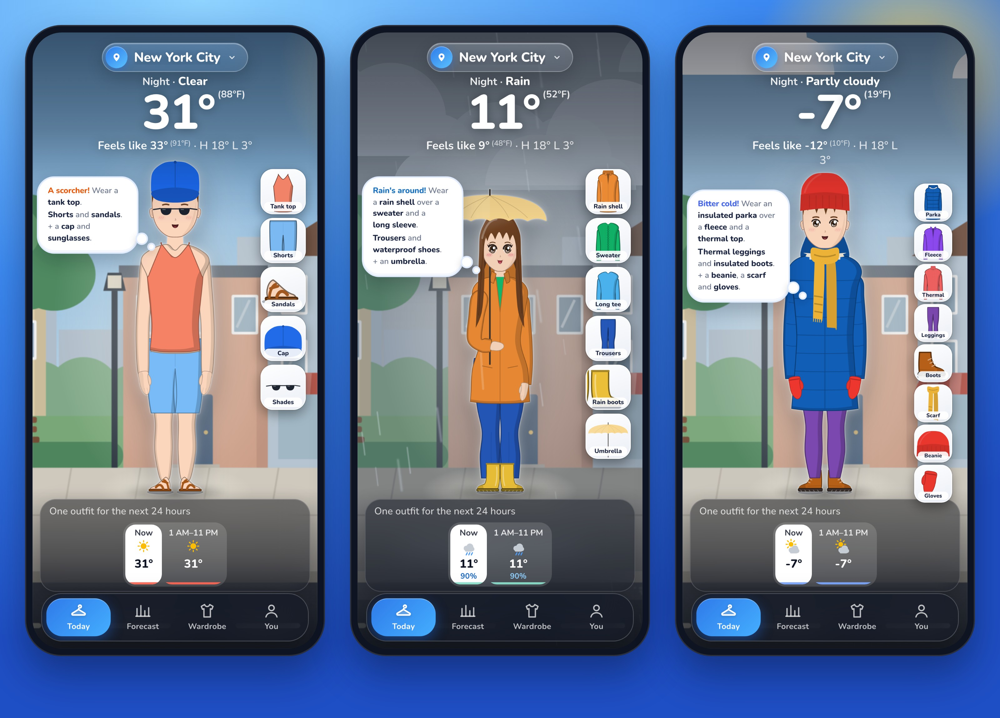

# WeatherFitMe: the fun weather app that tells you what to wear

**Tired of the boring default weather app?** WeatherFitMe is a fun alternative
to keep on your home screen: the weather hour by hour, and exactly what to
wear in it.

Forgot your umbrella again? Left your jacket at home on the coldest day of the
week? Not any more. WeatherFitMe sends you a short briefing every morning: how
the day will go, what to wear and what to pack. A friendly character dresses
for every hour of your day, and you get a heads-up before the rain or the cold
arrives.

### 👉 [Open WeatherFitMe](https://naimbh.github.io/weatherfitme/)

Free. No download, no sign-up, no ads.

**On Android?** WeatherFitMe is coming to Google Play.

## Why you'll love it

- **What to wear, hour by hour.** Not just a number: a rain shell by 3 PM, a
  lighter jacket at noon, boots before the snow. WeatherFitMe reads the wind,
  rain, snow, sun and how cold it really feels.
- **A character who looks like you.** Choose your skin tone, hair, face and
  style, and watch them dress for the day in a street that rains, snows and
  lights up at night.
- **A morning briefing.** One short notification each morning: today's weather
  and what to wear when.
- **A heads-up before the weather turns.** Hear about the rain, the cold snap
  or the jacket swap before it happens, even with the app closed.
- **Swipe through your day.** See the next outfit change in one swipe, or tap
  any day of the 10-day forecast.
- **°C and °F together.** The other scale sits in small brackets, so nobody
  has to do the maths.
- **Pick any location on the globe or map.** Spin a real Earth in satellite,
  map or night lights view, see the weather in the world's big cities and where
  it is night right now, then tap any place to add it. Map data from
  [OpenFreeMap](https://openfreemap.org) and
  [OpenStreetMap](https://www.openstreetmap.org/copyright); imagery from NASA.
- **Always a forecast.** If Open-Meteo is busy or down, the app quietly asks
  the next free service: Open-Meteo through WeatherFitMe's own service,
  [MET Norway](https://api.met.no), the
  [US National Weather Service](https://www.weather.gov/documentation/services-web-api),
  [Bright Sky](https://brightsky.dev) (Germany's weather service),
  [wttr.in](https://wttr.in) and [7Timer!](https://www.7timer.info), in that order.
- **Free.** No ads, no account and no tracking.

## ✨ Features

- 👕 **Hour-by-hour outfits:** what to wear for the wind, rain, snow, sun and real feel
- 🧑 **Your own character:** pick the skin tone, hair, face and style, then watch them dress for the day
- 🌆 **A living street:** rain, snow, sunshine and city lights at night
- 🗓️ **Hourly and 10-day forecasts:** swipe through your day or tap any day ahead
- 🌅 **Morning briefing:** one short notification with the day's weather and what to wear
- ⚠️ **Heads-up alerts:** rain, a cold snap or a jacket swap, before it happens
- 🌍 **Pick any location on the globe or map:** satellite, map and night lights views
- 🌡️ **Weather around the world:** live temperatures in big cities and the night side of the Earth
- 📍 **All your places:** your current location and every city you save
- 🔎 **Search any city:** with a backup search when one service is down
- ↔️ **°C and °F together:** the other scale sits in small brackets
- 🛟 **Always a forecast:** six free weather services back each other up
- 🔑 **Your choice of source:** pick a weather service, or add your own free API keys
- 📲 **Installs from the browser:** on iPhone, Android and computers
- 🤖 **Android app:** coming to Google Play, with home-screen widgets
- 🆓 **Free:** no ads, no account and no tracking

## Put it on your home screen in 10 seconds

WeatherFitMe installs straight from your browser and then works like any other
app: full screen, its own icon, and notifications.

- **iPhone or iPad:** open the link in Safari, tap **Share**, then
  **Add to Home Screen**.
- **Android:** open the link in Chrome, tap the **⋮** menu, then
  **Install app** (or **Add to Home screen**).
- **Computer:** open the link in Chrome or Edge and click the install icon in
  the address bar.

Then open WeatherFitMe from your home screen and turn on notifications under
**You > Notifications**.

## About this repository

This repository holds the published WeatherFitMe website, which GitHub Pages
serves at <https://naimbh.github.io/weatherfitme/>. The app's source code is
private.

Found a problem, or have an idea? [Open an issue](https://github.com/naimbh/weatherfitme/issues).

## License

The website may be used and shared for non-commercial purposes under the
[PolyForm Noncommercial License 1.0.0](LICENSE). Selling it, or using it in a
commercial product or service, is not allowed. The WeatherFitMe name, icon and
character are not covered by the license: see [TRADEMARKS.md](TRADEMARKS.md).

---

Made by Naim Bin Hasan · [Privacy policy](https://naimbh.github.io/weatherfitme/privacy.html) ·
[License](LICENSE)
